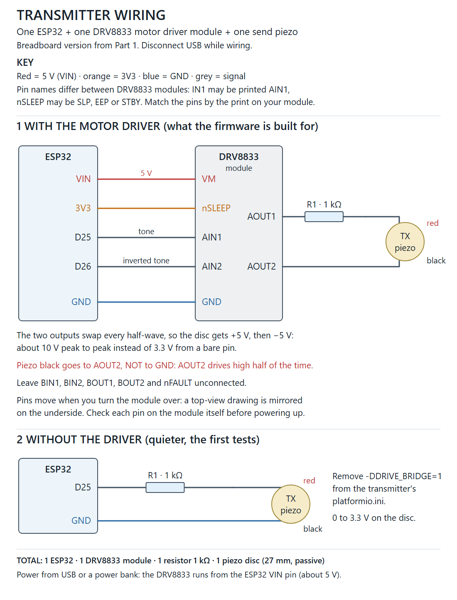
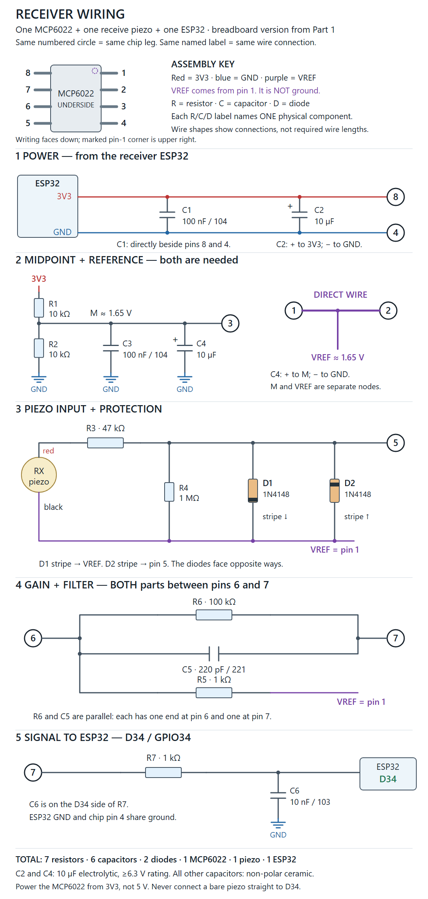

# Underwater piezo transmitter

Two ESP32 boards that send data with sound, through air and then through seawater, using cheap
27 mm piezo discs. This is the code and wiring from Part 1 of the video series, where everything
was built on breadboards.

Video: *link coming soon*

## How far it got

It only partly works so far. In Part 1 the link worked in air, as long as the discs were close
together and facing each other. In a dish of seawater it worked for about a minute.
Then salt water got to the bare rim of the disc, where the coating was missing, and the
receiver heard only noise.

## What's in here

| Folder | What it is |
|---|---|
| `firmware/transmitter/` | ESP32 transmitter: plays the tones through a DRV8833 motor driver and hosts the phone page |
| `firmware/receiver/` | ESP32 receiver: listens through the op amp, decodes the frames, blinks its LED |
| `schematics/` | Wiring for both boards, as SVG and PNG |

## Parts

- 2 × ESP32 dev boards (the original ESP32 with 4 MB flash, PlatformIO board `esp32dev`)
- 2 × 27 mm passive piezo discs (mine were sold as 4.6 kHz; the real peak was near 3 kHz)
- Transmitter: 1 DRV8833 motor driver module and a 1 kΩ resistor
- Receiver: 1 MCP6022 op amp, 7 resistors, 6 capacitors and 2 × 1N4148 diodes (values on the
  receiver sheet)
- Breadboards, jumper wires, and USB power for each board (a power bank works)
- For water: a coating for the discs. I used a two-part polyurethane resin for electronics.
  Coat the rim as well as both faces: an uncoated rim is what broke the seawater test.

My MCP6022 was the tiny surface-mount kind, so I soldered a wire to each leg. A SOIC-8 to DIP
adapter is easier, or buy the through-hole version (MCP6022-I/P).

## How it works

Each bit is one short tone: one frequency means 0, another means 1. A frame is 28 tones:
a fixed 12-tone header so the receiver can find the start, then 16 bits of payload. There is
no checksum yet, so a damaged payload can still get through.

The boards don't know the best tones for your discs in advance, so they calibrate:

1. Frequency sweep: the transmitter stays quiet while the receiver measures the background
   noise. Then it plays tones from 1 to 10 kHz in 250 Hz steps, five times each in random order.
   The two tones that clearly stand out above the noise every time become 0 and 1.
2. Symbol timing: the transmitter sends test frames with tones of 24, 16, 12, 8 and 6 ms.
   The boards keep the shortest tone length at which every frame arrived.

The boards save both results in flash, so they survive a restart. Run the calibration again whenever
you change the discs, the distance or the angle. In my tests the boards picked 1750 and
3250 Hz with 8 ms tones.

The data travels as sound. Wi-Fi (ESP-NOW) only runs the calibration and brings the receiver's
results to the phone. While the receiver listens for frames, its radio is off.

## Build and flash

1. Install [PlatformIO](https://platformio.org/) (the VS Code extension is easiest).
2. Open `firmware/transmitter/` as a project, connect the transmitter board and press Upload.
   Then do the same with `firmware/receiver/` and the receiver board.
3. Open the serial monitor at 115200 baud to see what each board is doing. Each board prints
   its firmware name at startup and again when you send `?`.

The platform is pinned to `espressif32@7.1.3`; newer Arduino cores changed the API for the tone
generator (LEDC) and won't compile this code without changes.

On Windows, the boards with a CP2102 USB chip need the
[Silicon Labs CP210x driver](https://www.silabs.com/software-and-tools/usb-to-uart-bridge-vcp-drivers).

If you have no motor driver, wire the disc straight to the ESP32 (section 2 of the transmitter sheet) and
remove `-DDRIVE_BRIDGE=1` from `firmware/transmitter/platformio.ini`. It works, just quieter.

## Using it

1. Power both boards.
2. On your phone, join the Wi-Fi network **PiezoModem-TX** (password **piezo1234**) and open
   **http://192.168.4.1/**. The phone may say the network has no internet; stay connected.
3. Wake the receiver: hold its BOOT button for 3 seconds, or press **Wake receiver (sound)** on
   the page. Its LED blinks once per second while it waits.
4. Press **Start calibration**. The page shows the sweep table, then the
   timing table, and whether it passed.
5. Press **Release receiver (radio off)** so the receiver goes back to listening.
6. Under **Air test**, press **Send test frames**. The receiver's blue LED blinks three times for
   every frame it decodes.

Change the Wi-Fi password in `firmware/transmitter/src/main.cpp` before you take it anywhere
public.

### LEDs

| Board | LED | Meaning |
|---|---|---|
| Receiver | off, then three quick blinks | listening; a frame arrived |
| Receiver | one short blink per second | radio on, waiting for the phone |
| Receiver | fast blinking | calibration running |
| Receiver | two short blinks / one long flash | calibration passed / failed |
| Transmitter | steady | the receiver is connected |
| Transmitter | short blink per second | no receiver connected |
| Transmitter | fast blinking | calibration running |

### Receiver serial commands (115200 baud)

| Key | Action |
|---|---|
| `?` | print the firmware name and status |
| `c` | turn the radio on and wait for the phone (same as holding BOOT) |
| `l` | back to listening, radio off |
| `1` / `2` / `3` | after `c`: start a frequency / timing / full calibration without the phone |
| `x` | cancel the running calibration |
| `n` | measure the background noise for 3 seconds |

The transmitter checks its drive pins at startup (you hear a short click) and prints
`DRIVE_TEST=PASS` or `FAIL`. That checks the ESP32 side only, not the driver or the disc.

## License

MIT, see [LICENSE](LICENSE). You can use this for anything, including commercial projects, as
long as the copyright notice stays with the code. If you build something with it, I'd love a
link back to the video.
